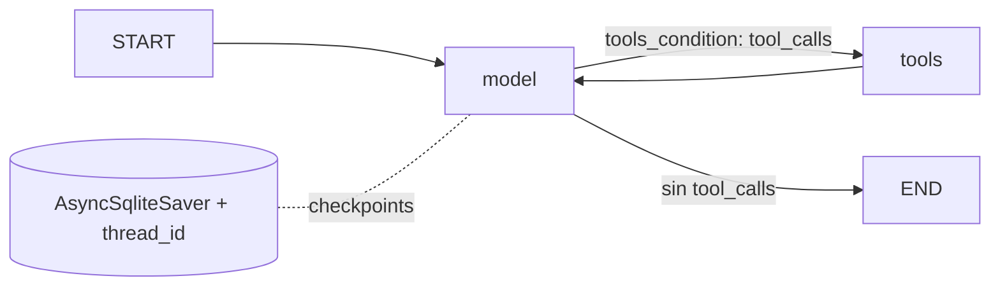

# Pre-entrega 5 · Agente de razonamiento cíclico con memoria persistente

Agente de consultas de pedidos con **Python 3.12+, LangGraph, OpenAI y SQLite**.
El modelo elige las herramientas mediante `bind_tools()`; el código no interpreta
palabras del usuario para seleccionar operaciones.

## Puesta en marcha

1. Clonar el repositorio y entrar en su carpeta.
2. Crear y activar un entorno Python 3.12:

   ```powershell
   py -3.12 -m venv .venv
   .venv\Scripts\Activate.ps1
   python -m pip install -r requirements-lock.txt
   python -m pip install --no-deps -e .
   Copy-Item .env.example .env
   ```

   En Linux/macOS: `python3.12 -m venv .venv`, `source .venv/bin/activate` y
   `cp .env.example .env`. El lock incluye herramientas de desarrollo.
   Para resolver otras versiones compatibles: `python -m pip install -e ".[dev]"`.

3. Completar **OPENAI_API_KEY** en `.env` y seleccionar un **OPENAI_MODEL** con
   acceso habilitado y soporte de herramientas. El ejemplo usa `gpt-4.1-mini`;
   la disponibilidad depende de la cuenta. Una suscripción de ChatGPT no configura
   automáticamente una clave para este programa. No subir `.env`.
4. Ejecutar dos procesos con el mismo hilo:

   ```powershell
   agente "¿Cuántos pedidos tuvo el cliente 102 y cuál fue el total?" --thread-id cliente-102 --trace traces/local-consulta.json
   agente "¿y el último?" --thread-id cliente-102 --trace traces/local-seguimiento.json
   ```

   Alternativa: `python -m agente.cli` con los mismos argumentos.
   La primera respuesta esperada es **3 pedidos por ARS 14.500**. La segunda:
   **pedido 1003, 28/10/2026, ARS 4.000**.

## Arquitectura y reglas



- `config.py`: entorno y validación de parámetros.
- `tools.py`: herramienta propia `@tool`, validación Pydantic y datos ficticios.
- `graph.py`: `AgentState(MessagesState)`, nodo asíncrono del modelo,
  `ToolNode`, `tools_condition` y retorno al modelo.
- `runtime.py`: ciclo de vida del checkpointer, invocación y traza JSON.
- `cli.py`: entrada del usuario y manejo de errores.
- `scripts/`: demostraciones offline y con OpenAI real.
- `tests/`: pruebas sin credenciales ni costos de API.

**Reglas del escenario simulado:** el cliente 102 tiene tres pedidos, el 103 existe
sin pedidos y cualquier otro ID devuelve un error. Los importes se almacenan en
centavos enteros ARS para evitar errores de coma flotante. Las fechas son ISO.
La herramienta devuelve hasta dos pedidos por página y `siguiente_cursor`.
Los resultados parciales no permiten concluir el total: el modelo debe consultar
la página siguiente. Es una operación de lectura, repetible sin duplicar registros.
Estas son reglas de la demostración, no reglas de un sistema empresarial real.

**Autonomía:** `ChatOpenAI.bind_tools(TOOLS)` expone los esquemas y docstrings al
modelo. `tools_condition` solo evalúa si su respuesta contiene llamadas; no hay
`if/else` por intención o texto del usuario. Las validaciones de argumentos y
errores de dominio sí usan condiciones normales.

**Ciclo de retorno:** `model → tools → model` permite leer observaciones, consultar
otra página, corregir argumentos recuperables o pedir aclaración. Un cursor fuera
de rango devuelve `cursor_sugerido=0`; un cliente desconocido requiere aclaración.
Los errores de ejecución y validación de herramientas se devuelven al modelo con
`ToolNode(handle_tool_errors=True)`. La instrucción limita a un reintento ante
errores recuperables; el límite duro del grafo evita ciclos indefinidos.

**Persistencia:** se utiliza `AsyncSqliteSaver` del paquete
`langgraph-checkpoint-sqlite`, equivalente asíncrono de `SqliteSaver`.
`SqliteSaver` síncrono no corresponde a las invocaciones `ainvoke/astream`.
El checkpointer se mantiene abierto con `async with` y se cierra correctamente.
Cada `thread_id` identifica una conversación; reusar el ID y la misma ruta SQLite
recupera el historial incluso al reiniciar el proceso. Un ID distinto aísla el
estado. Esto es memoria de conversación persistida, no búsqueda semántica global.

**Estado y contexto:** `MessagesState` incorpora el reducer `add_messages`, que
conserva IDs y permite `RemoveMessage`; no se modifica el estado in situ.
`MAX_CONTEXT_MESSAGES=40` es un máximo blando: se eliminan turnos antiguos
completos sin separar llamadas de sus respuestas. El turno activo se conserva
íntegro; `RECURSION_LIMIT=10` acota sus pasos. Al eliminar un turno se pierde su
contexto para futuras respuestas y puede ser necesario pedir el ID nuevamente.
Los checkpoints anteriores continúan en SQLite: esta poda no es borrado físico
ni política de retención. Para empezar de cero, usar otro `thread_id`.

## Pruebas y trazas

```powershell
pytest -q
ruff check .
mypy src
python scripts/demo_offline.py
```

La traza incluida en `traces/ejemplo-offline.json` se genera ejecutando **el grafo,
la herramienta y SQLite reales con un modelo simulado**. Registra dos llamadas
consecutivas (cursores 0 y 2), sus observaciones y un segundo turno después de
cerrar y reabrir SQLite. Las decisiones y respuestas del modelo están guionadas:
**esta traza no demuestra autonomía de OpenAI ni sustituye la aceptación en vivo**.

Para comprobar autonomía con una clave propia:

```powershell
python scripts/demo_live.py
```

Esta prueba usa un SQLite temporal independiente, exige al menos dos llamadas,
verifica los datos recuperados y reabre la memoria antes de preguntar
`¿y el último?`. Revisar las respuestas en `traces/local-openai.json`:

1. Debe consultar páginas 0 y 2 y responder 3 pedidos por ARS 14.500.
2. En el segundo turno debe conservar el cliente 102 y responder el último pedido.
3. Con `agente "Pedidos del cliente 999" --thread-id desconocido` debe pedir
   aclaración, sin presentar cero pedidos como un resultado válido.
4. Con otro `thread_id`, `¿y el último?` debe solicitar contexto.
5. Tras revisar que la traza solo contiene datos ficticios, copiarla como
   `traces/ejemplo-openai.json` para incluir evidencia de aceptación con LLM real.

La traza registra **acciones, observaciones y respuesta final**, no cadena privada
de pensamiento. No se solicita ni se publica razonamiento interno del modelo.
Los tests cubren paginación, importes, recuperación tras reapertura de SQLite,
aislamiento de hilos, retorno tras error, aclaración, recursión y poda de contexto.
Las respuestas de los dobles de prueba verifican el cableado del grafo, no la
exactitud ni las decisiones de un proveedor externo.

## Configuración, seguridad y límites

| Variable | Predeterminado | Uso |
|---|---|---|
| `OPENAI_API_KEY` | sin valor | Credencial obligatoria solo en ejecución real |
| `OPENAI_MODEL` | `gpt-4.1-mini` | Modelo con tool calling |
| `CHECKPOINT_DB` | `data/checkpoints.sqlite` | Archivo local de estado |
| `RECURSION_LIMIT` | `10` | Pasos por invocación, entre 2 y 100 |
| `MAX_CONTEXT_MESSAGES` | `40` | Contexto máximo blando, mínimo 4 |

- No hay claves en código, datos ni trazas versionadas. `.env`, SQLite y trazas
  locales están ignorados. Los logs operativos solo identifican nodos; las trazas
  opcionales contienen texto del usuario y datos de las herramientas.
- Las llamadas al proveedor tienen timeout de 30 segundos y hasta dos reintentos
  del cliente. Fallos de credenciales, conexión o cuota terminan con error de CLI.
- Si se alcanza el límite de recursión, usar un nuevo hilo o reformular. No se
  promete reanudar exactamente el punto fallido de una operación externa.
- El checkpoint persiste al finalizar cada paso; no garantiza ejecución exactamente
  una vez ante interrupciones. Aquí las herramientas son solo lectura. Para
  escrituras reales harían falta idempotencia y reconciliación.
- Ejecutar un turno por hilo a la vez. SQLite es adecuado para esta entrega local;
  no se presenta como base productiva de alta concurrencia. No hay autenticación,
  cifrado de historial ni notificaciones empresariales en este alcance.
- El programa se ejecuta bajo demanda. Si la computadora está apagada no procesa
  solicitudes; no incluye un servicio ni un planificador desatendido.

## Criterios de aceptación

| Criterio | Evidencia |
|---|---|
| Python 3.12+, async y type hints | `pyproject.toml`, `async def`, `mypy src` |
| Estado heredado de MessagesState | `AgentState` en `graph.py` |
| Modelo + herramientas + condición | `build_graph`, `bind_tools`, `tools_condition` |
| Herramienta propia y docstring | `buscar_pedidos` |
| SQLite persistente + thread_id | `open_agent`, prueba de reapertura |
| ≥2 llamadas y límite de recursión | Paginación, tests y demo offline; demo live para LLM real |
| Traza JSON | `traces/ejemplo-offline.json`, origen explícito |
| README y configuración sin secretos | Este documento, `.env.example`, `.gitignore` |

**Pendiente de validación con credencial propia:** ejecutar `demo_live.py` y
adjuntar la traza revisada para demostrar autonomía del modelo real. La entrega
no debe considerarse validada por completo solo porque pasen pruebas simuladas.

Referencias oficiales:
[persistencia LangGraph](https://docs.langchain.com/oss/python/langgraph/persistence),
[memoria y mensajes](https://docs.langchain.com/oss/python/langgraph/add-memory),
[AsyncSqliteSaver](https://reference.langchain.com/python/langgraph.checkpoint.sqlite/aio/AsyncSqliteSaver),
[OpenAI function calling](https://developers.openai.com/api/docs/guides/function-calling).
